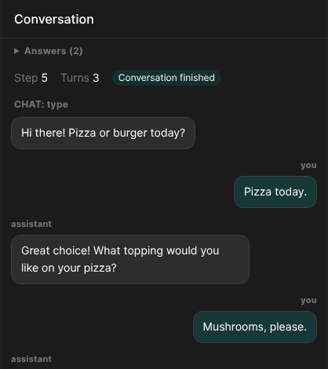

# Hosting and custom frontends

This guide explains how to host the builder for remote user tests and use its viewer and chat in your own frontend. Install it first by following [`README.md`](README.md).

## Hosting on a server

The builder is a single program, and you set up the rest of the hosting yourself. Any small Linux server you can reach over the internet will do, after following the steps in [`README.md`](README.md).

```bash
python server.py --host 0.0.0.0 --port 8200 --data ~/builder-data
```

Open that port in the server's firewall. The builder is then available at `http://<server address>:8200/`, and anyone can use its testing links. Testing links are text-only, so they need no further setup.

**Before you send the address to anyone:**

- **There are no passwords, and every visitor uses your model key, at your cost.** Anyone who has the address can use it, so give it only to people you trust, set a spending limit with the model provider, or put a password in front of it with a reverse proxy.
- **Keep it running** after you log out, for example with `tmux`, or `nohup python server.py ... &`.
- **Back up the `--data` folder.** It holds the testers' conversations and the links. Saved conversations stay in each person's own browser.

To change where conversations are saved, set `memory_vendor` in `dialogue_system_builder/mounts.py`. Use `"local"` for files in `--data`, `"cosmos"` for Azure Cosmos DB, or `None` to disable saving. The results pages only read `"local"`.

### Testing links

**Save the current conversation** creates a link, available under **Copy link**. Anyone with the link can talk to the conversation in a plain chat, without the canvas, and a results view shows each tester's run. Testers don't need an account or any setup. On a local machine the links work only on that machine, and on a server anyone who receives them can try it.

<p align="center"></p>
<p align="center"><sub>The tester's view at <code>/try/&lt;code&gt;</code>. <code>/results/&lt;code&gt;</code> shows what they said.</sub></p>

The `ConversationDesignPublicLinkToken` in the link is public and opens the chat page only. Each saved design also has a `ConversationDesignAPIKey`, `sk-` and 48 letters and digits, made at Save and returned to the browser that saved. A later Save of the same design must send it in the header `X-Conversation-Design-API-Key`, or the server refuses to change the design. The key is kept as it is in the link's JSON file under `<DIALOGUE_SYSTEM_BUILDER_DATA>/shares`, so the person hosting can read it there. A link saved before keys existed gets its key at its next Save, from whichever browser saves first.

### Voice on a server

To use WebRTC voice, install the voice extra as [`README.md`](README.md) describes. You also need:

- **HTTPS.** Browsers open the microphone only on HTTPS or on localhost. Put a reverse proxy such as Caddy or nginx in front of the port, and have it pass WebSockets and set `X-Forwarded-Proto`, so that links use the correct address.
- **A TURN server for visitors on restrictive networks, such as campus or mobile networks.** Set `TURN_URL` in `.env`. Without one, voice works only where the browser can reach the server directly.

Here is an example nginx configuration. Start the builder with `--host 127.0.0.1` and fill in your own domain and certificate. Voice audio doesn't pass through nginx.

```nginx
map $http_upgrade $connection_upgrade { default upgrade; "" close; }

server {
    listen 443 ssl;
    server_name builder.example.org;
    ssl_certificate     /path/to/fullchain.pem;
    ssl_certificate_key /path/to/privkey.pem;
    client_max_body_size 8m;

    location / {
        proxy_pass http://127.0.0.1:8200;
        proxy_http_version 1.1;
        proxy_set_header Upgrade $http_upgrade;
        proxy_set_header Connection $connection_upgrade;
        proxy_set_header Host $host;
        proxy_set_header X-Forwarded-For $proxy_add_x_forwarded_for;
        proxy_set_header X-Forwarded-Proto $scheme;
        proxy_read_timeout 3600s;
        proxy_send_timeout 3600s;
        proxy_buffering off;
    }
}
```

Reloading nginx drops the WebSockets of live conversations, so reload only when no conversations are active.

### Example deployment

An earlier version ran on one small Linux server with this setup:

- nginx in front of the builder on `127.0.0.1:8200`, with Cloudflare handling HTTPS.
- A systemd service with `Restart=always`, instead of `tmux`.
- One shared login with nginx basic auth, for the whole page.
- A limit of 6 requests a minute per visitor on `/api/generate`, because each request calls the model.
- A daily `rsync` copy of the data folder to another machine.
- A hosted TURN relay from Cloudflare for voice.

## Using the viewer and chat in a custom frontend

The canvas and the chat work without the editor, in a custom frontend, over the text WebSocket, the press-to-speak WebSocket or WebRTC voice. The example under [`examples/`](examples/flow-viewer) does this, with a server file for each of the three, and its [`README.md`](examples/flow-viewer/README.md) explains it. To rebuild them, install Node and run `npm install` in `frontend/`.

| You want | Build, in `frontend/` | You get |
|---|---|---|
| The whole builder | `npm run build` | `dist/` |
| The viewer alone | `npm run build:viewer` | `dist-viewer/` |
| The chat alone | `npm run build:chat` | `dist-chat/` |
