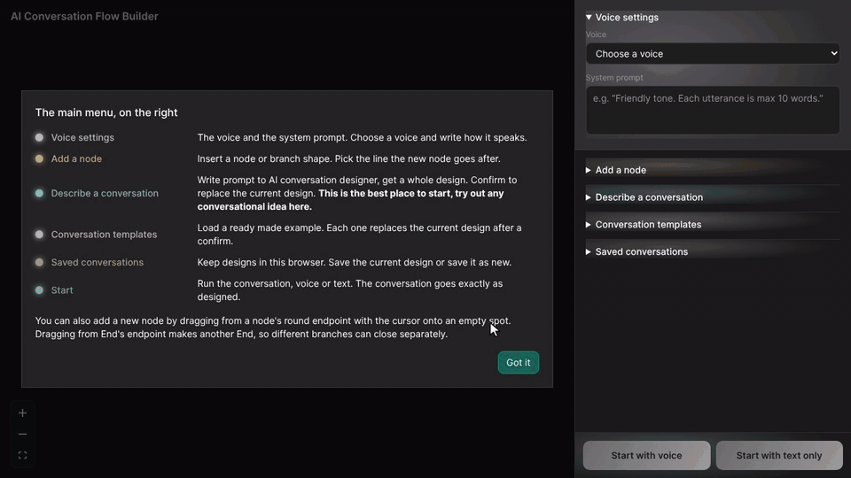
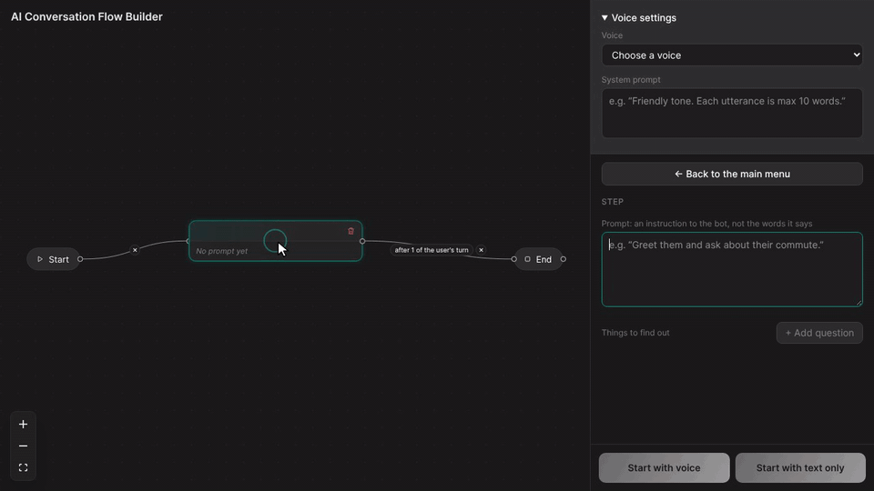
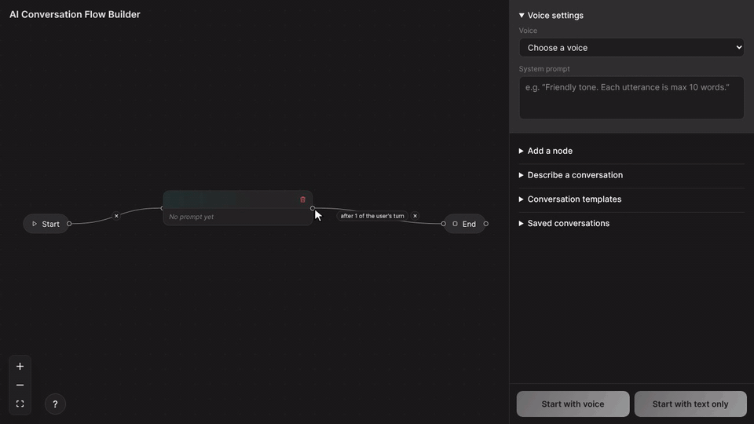
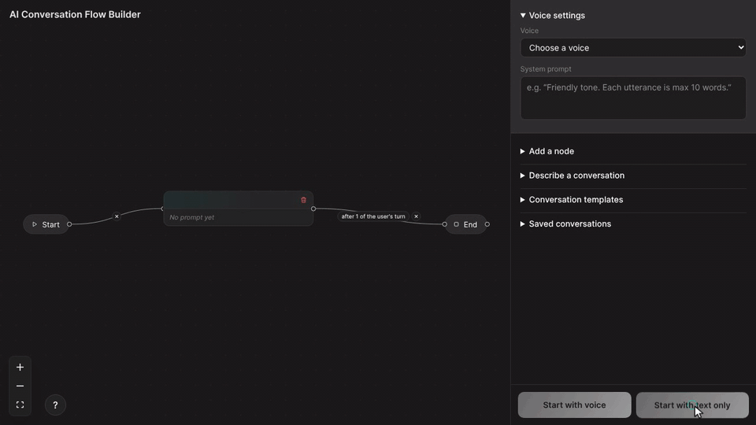
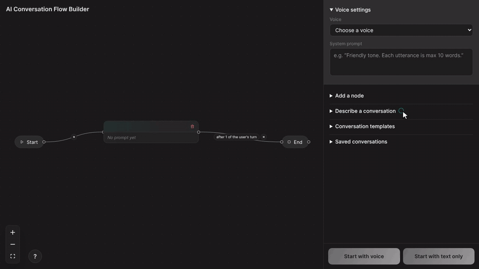

<h1 align="center">Dialogue System Builder</h1>

<p align="center"><strong>Build a conversation and test it by text or voice.</strong></p>

<p align="center">
  
  
  
  
  
  <a href="LICENSE"></a>
</p>

<p align="center">
  <a href="#features">Features</a> ·
  <a href="#installation">Installation</a> ·
  <a href="#build-a-conversation">Usage</a> ·
  <a href="#save-and-export">Saving and export</a> ·
  <a href="README-HOSTING.md">Hosting</a>
</p>

<p align="center">
  
</p>
<p align="center"><sub>A text conversation with a language model, sped up by a third. The highlighted step shows where the conversation is.</sub></p>

Dialogue System Builder is a no-code tool for building voice and text conversations with language models, in which you define the states, questions and transition rules, run the conversation live on [Illocutionary Lifecycles (IL)](https://github.com/LeoHuovinen/illocutionary-lifecycles), and export the result as a flow file. After each user turn, IL evaluates the answers and transition rules to select the next state, while the model generates only the response.

## Features

### Editor

A conversation consists of states connected by transitions. Each state has a natural-language prompt and can have questions. A transition enters the next state after a set number of user turns, when the user says a keyword or phrase, when all of the state's questions are answered, or when the user picks one of a question's choices. No programming is required.

**Templates.** Each template provides a complete conversation with editable prompts. Questions can be open or restricted to a fixed set of choices.

<p align="center"></p>

**Transition rules.** A transition can fire after a set number of turns, on a specific phrase, when all questions are answered, or on a selected choice.

<p align="center"></p>

**Common patterns.** The editor can insert a single state, a yes/no branch, a confirmation loop or a three-way branch into an existing transition. A preview shows the placement, and inserted states are connected and prefilled.

<p align="center"></p>

**Direct editing.** Dragging from a state's handle onto the canvas creates a connected state. Connecting a state to End closes the path.

<p align="center"></p>

**Validation.** Incomplete designs cannot start. Errors are listed and the affected state is marked, and the Start buttons turn green once the design is valid.

<p align="center"></p>

**Generation.** The model generates a complete design from a text description, including states, questions, choices and transitions, which replaces the current design after confirmation.

<p align="center"></p>

### Live view

Conversations run in text or voice mode. IL executes the design while the editor highlights the active state and transition, as in the recording at the top. The same view and chat also run in a custom frontend, over the text WebSocket or WebRTC voice, without the editor.

## Installation

Requirements are Python 3.11 or newer and an API key for Azure OpenAI or an OpenAI-compatible service. Node.js is not required.

**1. Clone both repositories into the same folder.**

```bash
git clone https://github.com/LeoHuovinen/illocutionary-lifecycles.git illocutionary-lifecycles
git clone https://github.com/LeoHuovinen/dialogue-system-builder.git dialogue-system-builder
cd dialogue-system-builder
```

**2. Create a virtual environment and install the dependencies.**

```bash
python -m venv .venv
source .venv/bin/activate              # on Windows: .venv\Scripts\activate
pip install -e "../illocutionary-lifecycles[text]"
pip install -r requirements.txt
```

**3. Configure the model.**

```bash
cp .env.example .env                   # on Windows: copy .env.example .env
```

Add the settings for one model to `.env`. IL's [environment variables](https://github.com/LeoHuovinen/illocutionary-lifecycles#environment-variables) table says what each one is for.

**4. Start the server and open http://127.0.0.1:8200/ in a browser.**

```bash
python server.py
```

**Start with voice** requires Pipecat, as described below. If a key is missing, pressing Start with text only tells you which one to set.

**To enable voice**, install IL's [`pipecat` extra](https://github.com/LeoHuovinen/illocutionary-lifecycles#install), fill in the Azure speech key and region in `.env`, and start it again. This is a larger install.

```bash
pip install -e "../illocutionary-lifecycles[text,pipecat]"
```

## Build a conversation

Start from **Describe a conversation** or **Conversation templates** in the sidebar. Then click a step to edit its prompt and questions, click a line to change when the conversation moves on, and press **Start with text only**. While you talk, the canvas lights up where the conversation is.

## Save and export

All of these are under **Saved conversations** in the sidebar.

| You want | Press | What you get |
|---|---|---|
| To keep it | Save the current conversation, and later Save (overwrite) or Save as new | Saved in this browser only |
| To move it to another browser or computer | Export design, Import design | A `.design.json` file of the canvas |
| To run it outside the builder | Download flow | A flow file that IL can run directly on any client, such as a browser, a native app or a robot. See [Run a conversation](https://github.com/LeoHuovinen/illocutionary-lifecycles#run-a-conversation) in IL's README |

## Hosting and user tests

An earlier version of this system was used in the course [HTI.560](https://www.tuni.fi/en/students-guide/curriculum/course-units/otm-e9ac04d0-a88c-423c-bd44-3e9a9126dffa?year=2024) at Tampere University. It can run on a server for remote user tests. See [`README-HOSTING.md`](README-HOSTING.md).

## Licence

MIT. Copyright (c) 2026 Leo Huovinen. The frontend libraries in the built pages keep their own licences, listed in [`THIRD-PARTY-NOTICES.md`](THIRD-PARTY-NOTICES.md).
